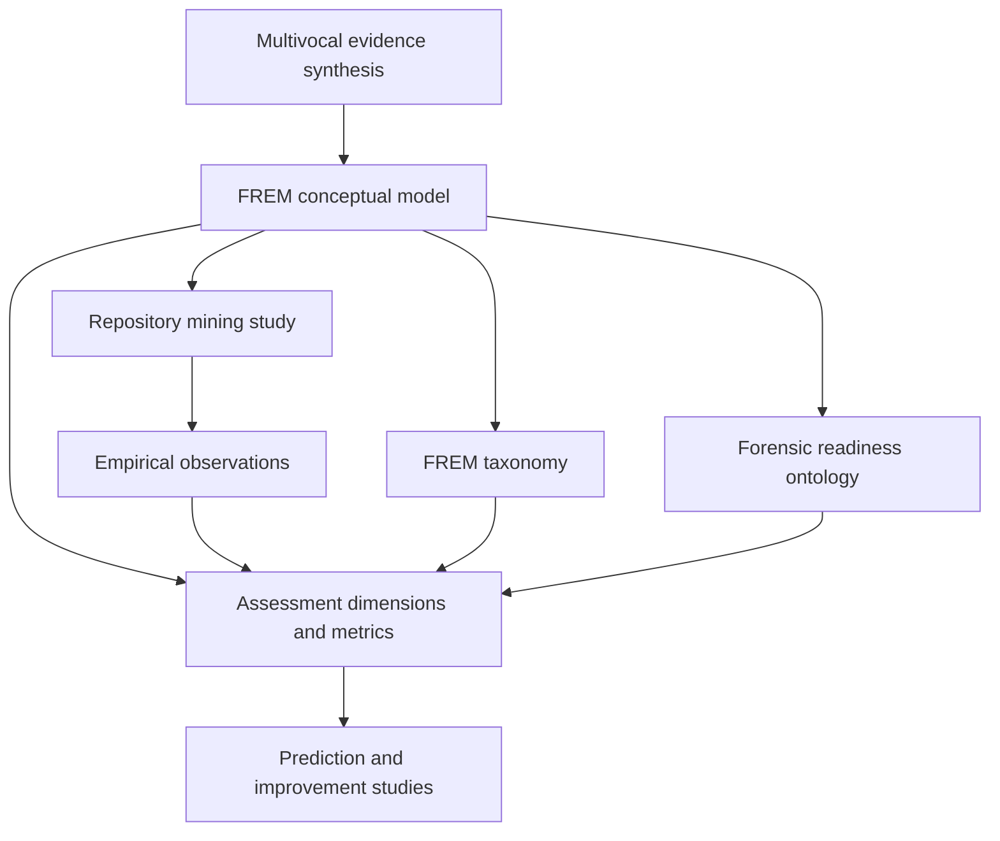

# Research Architecture

The scientific architecture connects the **evidence base** to **conceptual modeling**, **empirical observation**, and then to potential **assessment and improvement** mechanisms.

The arrows denote conceptual dependencies and potential research inputs, not completed validations. The taxonomy and ontology are separate outputs derived from the conceptual evidence base.

## Status boundaries

- **Scientific status**: planning, execution, analysis, or completion of the study itself.
- **Publication status**: manuscript preparation, submission, review, acceptance, or publication.
- **Artifact access**: planned, internal, or publicly released package.

These distinctions are deliberately maintained throughout the website.
